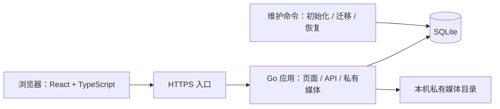

# 小小成长岛：技术方案

> 编写日期：2026-10-29。依据：[产品文档](product.md)。已确认技术方向：Go 后端、TypeScript 前端、SQLite 数据库。用户补充：最小适配设备为 iPhone 14，本文以竖屏 390 CSS 像素作为验收基线，取代产品文档中的 375 像素要求。本文是正式应用的实施设计，不表示相关功能已经实现、验证或部署。
>
> 2026-10-29 用户批准分阶段实施，并确认保持 KISS：CLI 仅负责初始化与忘记密码恢复，网页保留姓名和两种密码修改；退出管理后每次重新进入均需密码；不开发备份，不做真机验证。其余推荐参数已确认，见第 15 节。实际完成状态及证据见 [开发计划](../tasks.md)。
>
> 用户补充：数据刷新只围绕当前页面操作和跨日处理，不设计跨设备或跨标签页同步；服务端日期、权限及业务一致性校验仍适用。

## 1. 核心方案与范围

采用 **Go 模块化单体 + React / TypeScript 单页应用 + SQLite + 本地私有媒体目录**。生产环境由一个 Go 服务提供 API、前端构建产物和经过鉴权的附件访问，前置 HTTPS 入口。数据库和附件位于同一台机器的持久化磁盘。

选择 SQLite 的原因是使用规模明确：一个账户、一个小朋友、少量家庭设备。无需单独维护数据库服务，也无需为当前需求增加 Redis、消息队列、微服务或分布式锁。业务正确性由数据库事务、唯一约束和服务端校验保证，不依赖前端按钮是否禁用。

首版部署边界：一个应用实例、一份本地数据库、一个附件目录。多个浏览器可以同时访问同一个实例；不支持多台机器共享数据库文件，也不做离线写入与自动合并。

### 1.1 当前仓库事实

| 项目 | 当前状态 | 正式实现目标 |
| --- | --- | --- |
| 页面 | 原生 JavaScript 静态原型 | React + TypeScript，保留已确认的页面和交互规则 |
| 数据 | 浏览器 `localStorage` | 服务端 SQLite；浏览器只保留必要的界面偏好 |
| 登录与管理密码 | 演示校验 | 服务端口令校验、会话和管理解锁 |
| 照片 | 本地选择、预览 | 私有上传、访问、删除和中断恢复 |
| 录音 | 模拟计时与示例声音 | 浏览器实际采集、试听、上传和服务端校验 |
| 业务测试 | 原型领域规则测试 | Go 领域测试、真实 SQLite 事务测试、浏览器验收 |

已有 `src/domain.mjs`、`tests/domain.test.mjs` 可作为规则和用例来源，不能直接作为正式后端已经正确的证据。原型中的固定密码、示例余额和模拟录音不能迁入生产数据。

### 1.2 必须保持的产品契约

- 只有一个账户和一个小朋友；管理密码表示额外授权，不建立管理员角色体系。
- 站点固定使用 `Asia/Taipei`，周一为一周起点；客户端设备时区不改变业务日期。
- 普通入口只能新建今天的记录、修改或删除今天的记录；管理入口可以处理历史记录，但不能新增未来记录。
- 打卡发奖、删除回收、购买扣款必须可追溯；负余额合法，已经拥有的物品和奖励不因回收积分而撤销。
- 修改记录内容不改变记录身份、所属日期、项目、奖励和次数。纠正日期或项目采用删除后补录。
- 补录使用当前任务配置，不重建过去的配置；记录保存项目名称、图标及奖励快照。
- 永久物品不能重复购买；文本奖励每次购买产生独立待兑现记录。
- 普通界面、管理界面、弹窗均遵循大字体、触摸目标、键盘和减少动效要求。

### 1.3 非目标

首版不包含注册、多孩子、多角色、公开分享、排行、退款、转赠、审批、复杂等级、离线打卡、实时协作和自动扩容。本文不要求建设这些能力的预留框架。

## 2. 技术选型与整体结构

### 2.1 技术选型

| 层次 | 选择 | 理由与限制 |
| --- | --- | --- |
| 后端 | Go、标准库 `net/http`、`encoding/json` | 接口规模可控，优先标准库；业务逻辑不放在 HTTP 处理器内 |
| 数据访问 | `database/sql` + `modernc.org/sqlite` | 使用明确 SQL 和事务，免 CGO；不引入 ORM 或通用仓储框架 |
| 数据库 | SQLite，开启 WAL、外键 | 单机持久化，所有写入事务串行；适合当前使用规模 |
| 数据迁移 | 编号 SQL 文件、`schema_migrations` 表 | 由维护命令顺序执行并记录校验值，不另建迁移服务 |
| 前端 | React + TypeScript + Vite | 按页面和业务功能拆组件，TS 开启严格类型检查 |
| 前端数据 | 原生 `fetch` + 小型请求模块 + React 状态 | 统一请求和错误处理，各功能按需加载数据 |
| 界面样式 | CSS 变量与普通 CSS / CSS Modules | 复用原型视觉资产和大字规范，不另造组件框架 |
| 接口契约 | OpenAPI 3.1 | 记录请求、响应、错误和权限；生成 TS 接口类型，业务类型由 Go 显式定义 |
| 照片 | JPEG / PNG，服务端解码和重编码 | 已确认格式，去除原始元数据；首版不支持 HEIC 转码 |
| 录音 | `getUserMedia` + `MediaRecorder`；服务端 `ffprobe` 探测 | 浏览器选择可用格式；限制真实时长，首版不统一转码 |
| 测试 | Go `testing`、Vitest、React Testing Library、Playwright | 分别覆盖业务、组件和端到端流程 |
| 运行 | 单进程 + 持久化目录 + HTTPS 反向代理 | 可直接运行二进制；已有容器环境时再使用单容器 |

依赖版本在工程初始化时选择受支持版本，写入 `go.mod`、`go.sum` 和前端锁文件。本方案不以“最新版”作为可重复构建依据。`modernc.org/sqlite` 是免 CGO 的 `database/sql` 驱动，事务锁模式及逐连接参数见其[驱动文档](https://pkg.go.dev/modernc.org/sqlite)。

### 2.2 运行结构



前端与 API 同源，API 使用 `/api/v1` 前缀。开发时 Vite 将该前缀代理到本机 Go 服务。生产只暴露 HTTPS 入口，不将数据库或上传目录挂载成公开静态目录。

### 2.3 建议目录

以下是正式实施的目标结构；已有工程按当前文件复用并补齐，原型继续保留。各目录完成状态见开发计划。

```text
cmd/island/                   # 服务入口和 init / migrate / reset-password 维护子命令
internal/account/             # 账户、会话、管理解锁、偏好
internal/checkin/             # 类别、任务、记录、月历、统计
internal/shop/                # 商品、购买、所有权、装备、兑现
internal/wallet/              # 流水与余额更新，只被业务服务调用
internal/media/               # 上传校验、私有读取、引用与清理
internal/message/             # 家庭留言
internal/httpapi/             # 路由、鉴权、参数解析、错误转换
internal/storage/             # SQLite 连接、事务入口、迁移
internal/config/              # 配置装载与校验
internal/testkit/              # 测试时钟、临时数据库等工具，独立于业务文件
migrations/                   # 编号 SQL
api/openapi.yaml              # 接口契约
web/src/features/             # camp / calendar / stats / shop / settings 等
web/src/components/           # 少量跨功能复用的界面组件
web/src/api/                  # fetch 封装与生成类型
web/src/content/zh-CN.json    # 对用户展示的中文文案
web/src/assets/               # 经过确认的 SVG、角色、音乐
web/src/styles/               # 字体、颜色、布局与动效变量
config/app.example.yaml       # 非敏感配置示例
config/content.zh-CN.json     # 服务端确实需要输出的本地化文案
docs/product.md
docs/tech.md
```

业务服务明确依赖具体模块，不建设无复用的抽象层。只对时钟、事务执行和媒体文件操作等真实测试边界引入小接口。SQL 保持在所属业务模块，连接与迁移集中管理。

## 3. 日期、金额与数据约定

### 3.1 日期与时间

| 值 | 格式与语义 |
| --- | --- |
| `business_date` | `YYYY-MM-DD`，记录归属的台北日历日期，SQLite `TEXT` |
| `created_at` / `updated_at` | UTC Unix 毫秒，SQLite `INTEGER`；API 输出带时区的 RFC 3339 字符串 |
| `today` | 服务端当前时间转换到 `Asia/Taipei` 后的日期 |
| `weekdays` | API 为 1–7 数组，1 表示周一；数据库使用 1–127 的位掩码 |
| `start_date` / `end_date` | 均包含在范围内，按日历日期比较 |

Go 使用统一业务时钟并加载 `Asia/Taipei`；部署时保证时区数据可用，推荐将 `time/tzdata` 包含在二进制中。不可用时启动失败，不能静默使用操作系统时区。

普通新增请求携带 `expected_today`。取得写事务后读取一次服务端当前日期，作为该次操作的判断依据；与预期日期不一致时返回 `DAY_CHANGED`，保留草稿并要求刷新确认。成功响应返回实际 `business_date`。处理过程中不多次读取“今天”造成同一请求前后规则不同。

同一个已成功的幂等请求跨日重试，返回原成功结果，不再创建记录；新的请求必须重新校验今天。编辑和删除在事务中以当前日期校验权限。

历史补录分别保存所属日期和真实创建时间，展示“所属日期 + 补录标记 + 操作时间”，不提供历史完成时刻输入。

### 3.2 数值与标识

- 主键使用服务端生成的随机 UUID 文本；稳定标识与名称分离，改名不改变归组依据。
- 金币、钻石、价格、次数和库存均使用整数，不使用浮点数。数据库使用 `INTEGER`，Go 使用 `int64`。
- API 对余额与价格等整数限定在 JavaScript 安全整数范围内；写入前检查加减结果，越界返回错误并回滚。奖励、价格、库存另设合理的可配置上限，见第 15 节。
- 余额可以为负；任务奖励和商品价格必须非负；库存用 `NULL` 表示不限量，不能同时用 `-1` 表示。
- 记录内容、任务、类别、商品及账户资料编辑使用递增 `version`；请求携带 `expected_version`，过期时返回冲突。声音与动效偏好、装备仅更新指定字段、称号或形象槽位、单个饰品，采用后提交生效，不参与账户资料版本检查，也不递增该版本。
- 类型和状态使用 Go 常量、TS 联合类型和数据库约束明确表达，不散落魔法字符串。
- 文本存纯文本，客户端按文本渲染；不支持用户 HTML。可见文案集中配置，内部中文日志事件名允许写在代码中。

## 4. SQLite 与数据模型

### 4.1 连接和事务

首版只有一个 `*sql.DB`，设置 `MaxOpenConns(1)`、`MaxIdleConns(1)`。写事务通过驱动 `_txlock=immediate` 配合 `BeginTx` 开始；单条普通查询无需显式事务。汇总响应需要多条查询时，可使用 `BeginTx(ctx, &sql.TxOptions{ReadOnly: true})`，在同一短读取事务中取得一致快照，查询结束立即释放连接。

`modernc.org/sqlite` 在 `ReadOnly` 选项下使用普通 `BEGIN`，不套用 `_txlock=immediate`；该选项用于选择读取事务模式，不作为禁止写入的权限机制。读取事务只执行查询，不在其中升级为业务写入。实施时针对锁定的驱动版本验证这一行为；不新增只读连接池或通用查询框架。[驱动事务实现](https://gitlab.com/cznic/sqlite/-/blob/v1.33.1/sqlite.go)

连接建立时应用 `foreign_keys=ON`、`busy_timeout=5000`、`synchronous=FULL`；数据库初始化时启用并核对 `journal_mode=WAL`。连接级设置通过 DSN 或连接初始化机制应用，不能只在某次 `db.Exec` 后假定未来连接继承。五秒等待是初始技术参数，需结合请求超时验证。

SQLite 同时只允许一个写事务。`BEGIN IMMEDIATE` 在读取并校验业务状态之前取得写权限，锁冲突仍可能返回忙错误。首版把忙错误转换为可重试响应，不叠加无界重试。[SQLite 事务说明](https://www.sqlite.org/lang_transaction.html)

单连接会串行化应用的读写，符合当前规模。WAL 不会让这个连接池变成并行查询池；其文件必须位于本机文件系统，不放在 NFS、SMB 或同步盘中。后续只有测量证明读取阻塞明显时，再评估独立只读连接池。[SQLite WAL 说明](https://www.sqlite.org/wal.html)

实现约束：

1. 事务内部所有数据库操作均使用传入的 `*sql.Tx`，禁止回到 `db.*` 再取连接，也不嵌套事务。
2. 查询的 `Rows` 及时关闭；先读完并关闭，再执行同池中的下一条查询。禁止一边遍历未关闭结果、一边从同池调用新的服务查询。
3. 密码哈希、媒体上传、解码、文件探测、网络调用不放进数据库事务，读取事务同样保持短小。
4. 事务失败整体回滚；提交成功后才向客户端报告成功。事务外派生动作不能决定币值是否生效。
5. `schema_migrations`、会话与清理任务同样遵守连接使用规则；后台工作分批执行，不长时间占用唯一连接。

Go 官方建议使用 `sql.Tx` 管理事务，并避免混用事务外 `sql.DB` 操作；这也是单连接池避免自我等待的必要条件。[Go 事务指南](https://go.dev/doc/database/execute-transactions)

### 4.2 表结构

以下字段为实施基线。所有必填字段使用 `NOT NULL`；省略的外键目标均是对应表的 `id`。采用 SQLite `STRICT` 表时，日期和布尔值仍使用 `TEXT`、`INTEGER`，不写不存在的严格类型。布尔字段加 `CHECK(value IN (0,1))`。

| 表 | 主要字段 | 约束与用途 |
| --- | --- | --- |
| `accounts` | `id`、`username`、`display_name`、`login_password_hash`、`management_password_hash`、`credential_version`、`music_enabled`、`effects_enabled`、`reduce_motion`、`title_purchase_id`、`avatar_purchase_id`、`version`、时间字段 | `id=1` 固定单账户；用户名唯一且只读；密码分别哈希；`version` 仅用于姓名等账户资料编辑，密码使用独立的 `credential_version`；偏好和装备不递增资料版本；称号和形象字段引用永久物品订单，空形象使用内置默认形象；饰品使用独立关联表 |
| `sessions` | `id`、`account_id`、`token_hash`、`csrf_token`、`expires_at`、`management_expires_at`、`management_version`、`credential_version`、时间字段 | 会话 token 哈希唯一；CSRF token 为独立随机值，单独持有不能登录；授权绑定具体会话；注销删除会话；不存明文 cookie |
| `categories` | `id`、`name`、`sort_order`、`version`、时间字段 | 非空名称；只有没有引用它的项目时才能删除 |
| `tasks` | `id`、`category_id`、`name`、`icon_key`、`coin_reward`、`diamond_reward`、`daily_limit`、`weekday_mask`、`enabled`、`deleted_at`、`version`、时间字段 | 奖励非负，每日上限正数，星期非空；删除为软删除，保留历史关联 |
| `checkins` | `id`、`task_id`、`business_date`、`task_name_snapshot`、`task_icon_snapshot`、`coin_reward_snapshot`、`diamond_reward_snapshot`、`text`、`photo_media_id`、`audio_media_id`、`source`、`deleted_at`、`version`、时间字段 | `source=today/backfill`；日期和项目创建后不可改；每种媒体至多一个；不设置任务与日期唯一约束，因为允许每日多次 |
| `wallets` | `account_id`、`coins`、`diamonds`、`version` | 每账户一行，初始化为零；允许负值；保存当前余额 |
| `wallet_entries` | `id`、`account_id`、`event_type`、`checkin_id`、`purchase_id`、`coin_delta`、`diamond_delta`、`created_at` | 不可修改的变动流水；事件为 `checkin_grant/checkin_revoke/purchase_debit`；检查引用与事件匹配 |
| `products` | `id`、`type`、`name`、`asset_key`、`description`、`coin_price`、`diamond_price`、`stock`、`enabled`、`deleted_at`、`version`、时间字段 | 类型为 `title/avatar/accessory/reward`；价格非负；库存为空或非负；有订单后类型不可改变 |
| `purchases` | `id`、`product_id`、商品快照字段、成交双币价格、`status`、`redeemed_at`、`version`、`created_at` | 永久物品 `owned`，文本奖励 `pending/redeemed`；成交快照不可变；不提供退款状态 |
| `equipped_accessories` | `purchase_id`、`equipped_at` | `purchase_id` 为主键并引用永久饰品订单；每件饰品最多一条；事务内限制总数不超过 10，允许为空 |
| `media_files` | `id`、`storage_key`、`kind`、`mime_type`、`size_bytes`、`duration_ms`、`width`、`height`、`sha256`、`state`、`created_at`、`unreferenced_at` | 文件键唯一；状态为 `ready/attached/deleting/deleted`；系统不按文件哈希跨用户公开复用 |
| `messages` | `id`、`text`、`created_at` | 去空白后非空；新增和删除需要登录，不需要管理授权 |
| `idempotency_requests` | `account_id`、`operation`、`key`、`request_hash`、`resource_id`、`http_status`、`response_json`、`created_at` | 组合主键 `(account_id, operation, key)`；与业务结果同事务提交 |
| `schema_migrations` | `version`、`checksum`、`applied_at` | 已执行脚本不得修改；失败不记录为成功 |

`accounts.id=1` 是单账户产品的明确建模选择，不以每张表都添加租户列来伪装多租户支持。业务数据天然属于唯一账户；若以后扩为多账户，需要重新设计归属、约束和访问控制，不能只开放注册接口。

### 4.3 关键约束与索引

- `checkins(task_id, business_date) WHERE deleted_at IS NULL`：事务内检查当日次数。
- `checkins(business_date, created_at, id) WHERE deleted_at IS NULL`：日周列表、月历和范围统计。
- `tasks(category_id)`、`products(enabled, deleted_at, type)`、`purchases(created_at, id)`、`messages(created_at, id)`：对应页面查询。
- 流水使用部分唯一索引：`UNIQUE(checkin_id, event_type)` 和 `UNIQUE(purchase_id, event_type)`，只针对各自非空引用。每条记录最多发一次、回收一次；每笔订单最多扣一次。
- `wallet_entries` 的 `CHECK` 保证奖励事件只引用记录、购买事件只引用订单；金额方向符合事件类型，零奖励或免费购买也允许零变动。
- `purchases(product_id) WHERE type_snapshot IN ('title','avatar','accessory')` 建立唯一索引，阻止永久商品重复购买；订单本身即所有权，无需再维护一张物品库存表。
- `checkins.photo_media_id` 和 `audio_media_id` 分别建立非空唯一索引，媒体类型在事务内校验，禁止一个文件同时被多个记录占用。
- `media_files(state, unreferenced_at)` 支持回收；`sessions(expires_at)` 支持过期清理。
- 历史对象引用采用限制删除或保留父行，不使用级联删除抹掉记录、订单、流水或所有权。

删除任务时将其软删除并清空 `category_id`，使其不再阻止删除空类别；普通停用仍保留类别关系。删除类别遇到任何仍引用它的任务，包括停用任务，都要求先移动或删除这些任务。

### 4.4 快照与余额核对

记录快照至少包含项目名称、图标、两种奖励。订单快照至少包含商品类型、名称、描述、资产标识和成交价格；资产标识指向不可覆写的版本。历史快照引用的任务图标和装扮素材保存在持久化目录 `data/assets/`，不依赖旧发布目录；任务或商品删除后仍保留。首版不自动清理该目录，避免为少量内置素材增加回收机制。本轮不开发备份。

余额以钱包行提供快速查询，流水用于追溯和核对：`wallets.coins = SUM(wallet_entries.coin_delta)`，钻石同理。两者每次在同一事务更新；首版不开放手动改余额接口。维护检查发现不一致时报告并调查，不静默覆盖数据。

删除记录保留最少业务快照和回收依据，清空文字、解除附件引用；普通查询统一过滤 `deleted_at IS NULL`。已解除引用的媒体立即禁止访问，物理文件延迟清理。

## 5. 业务流程与一致性

### 5.1 新增打卡与管理补录

媒体先完成上传校验，再以媒体 ID 参与业务提交。以下步骤处于同一个短写事务：

1. 确认会话仍有效；按操作类型检查普通权限或管理解锁。
2. 查幂等键。已成功且请求摘要相同则返回原结果；摘要不同返回冲突。
3. 固定本次服务端日期，校验普通请求的 `expected_today`，或补录的非未来日期。
4. 读取当前任务，确认没有删除、仍启用、适用于目标星期，且任务版本与确认弹窗一致。
5. 统计同一任务、同一日期的有效记录数，确认小于当前 `daily_limit`。已有次数大于新上限时不删除旧记录，只禁止新增。
6. 确认新媒体存在、类型匹配、状态为 `ready` 且 `unreferenced_at IS NULL`，未被其他记录占用、未进入清理状态。编辑时保留当前记录原有媒体不视为重新关联。
7. 创建记录和快照；写入奖励流水；增加钱包两种余额；将媒体改为已关联。
8. 保存幂等成功结果并提交，返回记录、余额和本次任务剩余次数。

任务配置在弹窗打开后变化时返回 `TASK_CHANGED`，展示最新配置再确认，不能静默改变用户已看到的奖励。管理员补录也使用当前任务配置，不能使用已停用或已删除的任务新建记录。

写事务串行化“读取次数 → 新增记录”，因此无需额外维护每日次数表。任务配置变更同样通过写事务执行，不会在记录校验和快照生成之间插入另一笔修改。

### 5.2 编辑、删除与纠正记录

**内容编辑：**事务内校验记录未删除、日期权限及 `expected_version`，只更新文字、照片、录音和版本。换附件时先确认新文件可用，再替换引用，旧文件随后进入待清理状态。奖励流水、业务日期和项目保持不变。

**删除：**事务内读取有效记录并校验权限和版本；置删除标记、清空内容和媒体引用；按记录的原奖励写回收流水；扣钱包余额；提交。余额不足不阻止回收，也不修改订单或装备。

第一次删除后的重复删除返回资源已删除的成功状态和当前钱包，不重复扣回。重复请求仍须通过当前会话及路由要求的管理鉴权；已删除状态在日期检查之前识别，因此响应丢失后跨日重试也能恢复成功结果。未删除的历史记录仍只能通过管理接口删除。已删除记录的流水唯一约束作为最后一道一致性保障。

**纠正日期或项目：**管理界面先展示原记录回收金额和新记录可能使用的奖励，再执行删除、补录两个操作。删除成功而补录失败时，旧记录保持已删除，补录草稿保留并明确提示当前状态。首版不引入隐式补偿、事务跨请求或“改日期但保留原奖励”的接口。

### 5.3 购买与永久所有权

购买确认请求包含 `product_id`、`expected_product_version`、`expected_wallet_version` 和幂等键。钱包版本参与确认，是为了避免弹窗展示的购买后余额与真实扣款依据不一致。

同一写事务内依次执行：

1. 检查幂等结果，读取当前商品和钱包。
2. 确认商品可购买、商品和钱包版本未变化；有变化则返回最新状态，由用户重新确认。
3. 对两种货币分别检查 `balance >= price`。价格为零也要检查，因此任一种余额为负都会阻止免费购买。
4. 检查有限库存大于零；永久类型检查不存在相同商品的永久订单。
5. 创建不可变成交快照；永久商品订单状态为 `owned`，文本奖励为 `pending`。
6. 扣减两种余额，写购买流水；有限库存减一并增加商品版本；保存幂等结果并提交。

任一步失败都不扣款、不扣库存、不生成有效订单。免费商品仍创建订单和零金额流水，以保持购买追溯一致。

“我的装扮”查询永久订单，购买不自动装备。称号和形象保存对应订单 ID，事务内检查有效登录、订单所有权以及类型与槽位匹配，只更新指定槽位，不提交或替换整份账户。不同槽位互不覆盖，同一槽位以服务端后提交的操作为准，不校验账户资料版本。形象槽为空时使用默认形象；称号槽可为空。商品下架后仍根据订单快照装备和展示。

饰品使用 `equipped_accessories` 保存已装备订单，可同时装备 0–10 个不同饰品。装备时在同一写事务内检查订单所有权及饰品类型；已装备则返回成功且不重复计数，否则检查当前数量小于 10 后插入。达到上限时拒绝新增，保留现有装备；上限不限制持有或购买数量。卸下仅删除指定饰品关联，重复卸下返回未装备的成功状态。单个饰品的装备与卸下以服务端后提交生效，操作不影响其他饰品，也不递增账户资料版本。数量检查和插入必须在同一写事务中完成，避免并发突破上限。

`GET /camp` 返回称号、形象及全部已装备饰品的订单快照和素材引用；饰品按装备时间、订单 ID 稳定排序。装备操作成功后刷新角色区，重新进入或刷新页面时从保存状态恢复，未装备物品不参与主页展示。

### 5.4 奖励兑现

每次兑现确认都需要输入管理密码，不能只因为曾进入过管理页就跳过本次验证。请求直接提交密码与奖励订单 ID，通过 HTTPS 传输，服务端不记录密码。

密码校验在事务外执行，同时读取凭据版本；随后事务内核对版本未变、会话有效、订单类型为文本奖励。将 `pending` 条件更新为 `redeemed` 并写入兑现时间。已经兑现时返回当前状态，不再执行副作用；兑现不改变余额和库存。

管理页面的解锁用于配置与历史管理，兑现验证仅授权本次兑现，不顺便把管理页面解锁。

### 5.5 幂等、重试与版本冲突

| 机制 | 用途 | 客户端行为 |
| --- | --- | --- |
| `Idempotency-Key` | 新建记录、购买、留言、管理新增任务/类别/商品等可能重复创建的命令 | 一次明确提交生成一个 UUID；超时或断网重试使用原键 |
| `expected_version` | 记录内容、任务/类别/商品配置、账户资料及相关删除操作，防止覆盖新状态；不用于偏好和换装 | 冲突时保留草稿，重新获取数据，让用户决定后再提交 |
| 状态条件更新 | 删除回收、奖励兑现 | 重复操作不再次回收或兑现 |
| 数据库唯一约束 | 永久商品、经济流水、幂等记录 | 即便应用误判，也不能产生重复经济事实 |

请求摘要取规范化后的业务字段、操作类型和 API 版本，不包含密码、Cookie 或临时管理凭据。幂等表只保存必要响应，避免复制照片、音频和完整文字。经济操作的幂等记录首版不自动清理，避免过期重试产生第二笔业务；低风险新增记录的清理规则在实施时单独确定，未确定前保留。

任务和类别编辑冲突后保留草稿，重新加载并展示最新配置。用户可以将最新配置载入表单，或明确选择以当前草稿覆盖并保存；仅更新版本号不能代替确认。加载失败时不能覆盖，再次发生冲突时重新加载和确认。

权限检查必须先于幂等结果读取，不能用旧请求键绕过已经失效的登录或管理解锁。除此之外，已成功请求应先于今日日期、商品现价等重新校验返回原结果。

业务失败整体回滚，不保存“成功”。客户端区分明确失败与结果未知，提交时保留原始请求和幂等键，不能用之后编辑的草稿覆盖原始请求。

- 收到服务端明确的业务失败结果后，用户可以修改任务、日期、媒体或重新确认价格，再以新键提交。
- 网络超时、连接断开或提交结果不明时，先用原键和原始请求恢复结果；修改草稿、关闭弹窗或取消前端请求均不能视为服务端已撤销，也不能据此换键再创建。结果未确定时保留待确认提交，阻止将其草稿另作新建；暂时失去登录或管理权限时，恢复授权后继续核对。
- 原请求成功后，打卡草稿的文字或附件变化转为对返回记录 ID 的内容编辑，不再新建或发奖；日期或项目变化仍走管理界面的删除后补录。购买则展示原订单；另买一份必须在确认原结果后重新发起。

恢复结果复用已有命令的幂等重放，不增加操作查询服务或后台任务队列。

打卡幂等表保存记录 ID、原事务钱包、剩余次数及日期等紧凑经济收据。首次响应及重放响应中的 `checkin` 读取当前记录内容和版本；已删除记录返回 `deleted=true` 且内容为空，不恢复记录或发奖。幂等保证业务身份与经济事实不重复，不承诺可变内容的 HTTP 响应逐字相同。前端看到已删除状态不得重新插入记录或播放成功动画，核对后重新读取列表和营地。

已有响应中的余额仅代表该次事务完成时的快照；幂等重放后前端仍刷新最新数据，不能把旧余额覆盖当前余额。打卡成功动效按记录 ID 去重，不因重新获取数据而重复播放。

## 6. 登录、管理授权与账户维护

### 6.1 登录会话

采用服务端不透明会话，不在浏览器 `localStorage` 保存 JWT 或密码。登录成功生成随机会话令牌，数据库只保存哈希；Cookie 设置 `HttpOnly`、`Secure`、`SameSite=Lax`，并限制为当前站点。开发环境 localhost 的例外仅用于本机开发。

所有写请求校验来源和 CSRF token；登录也校验请求来源。前端从当前会话接口取得 CSRF token 并随写请求发送，服务端核对会话绑定值。生产配置允许的站点来源，不接受客户端任意指定。

密码使用带独立随机盐的 Argon2id 哈希，参数随哈希一起存储，按部署机器测量成本后固定配置；不自制密码散列算法。登录和管理密码分别校验，不要求二者相同。登录失败采用统一身份错误，字段格式错误可以具体提示；失败次数按账户与来源限速，避免永久锁死唯一家庭账户。

单个账户服务同时只执行一个密码校验或哈希计算，登录、解锁、改密码、兑现及维护入口共享这一限制。等待可随请求取消，获得执行名额后重新检查失败次数；失败记账完成后才释放名额，成功不消耗失败预算。密码计算结束后释放名额，再进入写事务复核凭据和权限。已开始的 Argon2 计算不能中途取消，现有哈希参数兼容范围保持不变。

服务端检查会话过期时间和凭据版本。登录最长七天、管理解锁三十分钟；访问不会无限延长管理授权。退出管理后再次进入必须重新输入管理密码，不能复用前端缓存的解锁状态。

登录、管理解锁、改密码和兑现都遵循相同的凭据检查顺序：事务外读取哈希与 `credential_version` 并完成慢速密码校验，事务内重新读取账户，确认版本未变再写入会话或业务结果。已登录操作同时复核会话仍存在、未过期、会话与账户的 `credential_version` 一致；不使用账户资料的 `version` 判断登录有效性。凭据版本变化时拒绝本次旧校验结果，不能把旧密码校验成功转成新凭据版本的有效会话。

### 6.2 管理解锁

`POST /management/unlock` 验证管理密码后设置当前会话的管理有效期。配置请求都在服务端检查有效期；浏览器中的已解锁状态只用于呈现。

解锁在密码校验前读取当前会话的 `management_version`，写入时要求版本仍匹配；解锁、锁定均递增这个版本。这样用户点击锁定后，先前仍在校验密码的解锁请求不能重新恢复管理授权。普通管理写操作也在业务事务中复核授权，不能只依赖事务开始前的中间件结果。

点击退出管理时调用 `POST /management/lock` 撤销授权，成功后返回普通页面。若网络失败，界面立即隐藏管理内容并提示锁定尚未确认，联网后优先重试；服务端最长保留至原授权到期。关闭标签页或浏览器的通知不能作为可靠撤销依据。

授权按登录会话生效。退出管理或退出登录后，当前页面立即清除相应内容；不建立标签页间通知机制。共享该会话的其他页面在后续请求时由服务端拒绝失效授权，并按 `401` 或 `403` 清除相应状态，旧页面不能作为继续操作的授权依据。

### 6.3 修改密码和初始化

修改任一密码要求管理解锁，并校验对应旧密码、新密码、确认密码。成功后更新密码哈希和凭据版本，撤销所有会话，要求重新登录。请求不能接受 `isAdmin` 或 `unlocked` 等客户端权限声明。

初始化使用服务器本机维护命令，交互式读取用户名、姓名和两种密码，创建唯一账户、零余额及默认形象引用。密码不写进命令行参数、仓库或日志；已有账户时拒绝重新初始化。

忘记密码通过拥有服务器访问权限的维护命令重置指定密码并撤销所有会话，不开发邮件或短信找回。此方式已由用户确认；网页仍保留输入旧密码的登录密码及管理密码修改。

## 7. HTTP API 契约

### 7.1 通用规则

- JSON 字段统一 `snake_case`；请求与响应通过 OpenAPI 描述。未知业务字段拒绝，避免误传日期、奖励等本不允许修改的值。
- 登录与管理密码只通过 HTTPS 请求体传输，不放 URL；上传使用 `multipart/form-data`。
- 成功读取返回 `200`，新建返回 `201`，无响应体删除可用 `204`。需要返回余额的删除返回 `200`。
- 错误统一包含 `code`、`field_errors`、`request_id`，可按需携带 `current_version` 等结构化详情。用户文案由资源文件映射，不让前端解析错误文字。
- 历史记录、留言、订单使用 `(created_at, id)` 稳定游标分页；默认 50、最大 100。按日期展示记录时分页顺序同时包含 `business_date`，明确返回下一页游标。
- 单次列表最大日期跨度 31 天；自定义统计最多 366 天。不能因分页只返回第一页而声称这是某日或一周的完整记录，界面应继续加载并标示状态。
- 返回 `server_now`、`today` 和 `timezone` 的会话/营地响应为前端日期依据。跨请求聚合到同一屏时以刷新批次号丢弃旧响应。

### 7.2 接口清单

所有路径以 `/api/v1` 开头。“管理”表示有效登录会话且已服务端解锁。

| 方法与路径 | 权限 | 主要请求 / 结果 |
| --- | --- | --- |
| `POST /auth/login` | 无，校验来源、限速 | 用户名、密码；建立 Cookie 会话 |
| `POST /auth/logout` | 登录 | 删除当前会话，同时撤销管理授权 |
| `GET /session` | 登录 | 姓名、偏好、CSRF token、授权有效期、服务端日期、媒体限制 |
| `POST /management/unlock` | 登录 | 管理密码；返回授权有效期 |
| `POST /management/lock` | 登录 | 撤销当前会话管理授权 |
| `PATCH /account/profile` | 管理 | 姓名、账户资料版本；用户名不能修改 |
| `PATCH /account/preferences` | 登录 | 只传本次改变的音乐、音效或减少动效字段及目标布尔值；无需版本，同字段后提交生效 |
| `POST /account/login-password` | 管理 | 旧密码、新密码、确认密码 |
| `POST /account/management-password` | 管理 | 对应旧密码、新密码、确认密码 |
| `GET /camp` | 登录 | 今天任务、钱包、装备、账户偏好及任务完成状态 |
| `GET /checkins?start_date=&end_date=&cursor=` | 登录 | 有效记录，包含快照、附件标记、可执行动作 |
| `POST /checkins` | 登录 | 任务 ID、预期今天、任务版本、文字和媒体 ID；不能传任意日期 |
| `PATCH /checkins/{id}` | 登录 | 今天的内容和版本；历史请求拒绝 |
| `DELETE /checkins/{id}` | 登录 | 今天的记录及版本；返回回收后余额 |
| `GET /calendar?month=YYYY-MM` | 登录 | 每日次数、有限图标摘要及更多数量；详情走记录接口 |
| `GET /stats?start_date=&end_date=` | 登录 | 按项目 ID 汇总次数、总次数和有效天数 |
| `GET /categories`、`GET /tasks` | 登录；包含停用项需管理 | 当前配置，`include_inactive=true` 提供管理页所需配置 |
| `POST /management/categories`、`PATCH /management/categories/{id}`、`DELETE /management/categories/{id}` | 管理 | 类别新增、改名、删除；非空类别拒绝 |
| `POST /management/tasks`、`PATCH /management/tasks/{id}`、`DELETE /management/tasks/{id}` | 管理 | 任务配置；删除保留历史 |
| `POST /management/checkins` | 管理 | 目标日期、任务、版本、内容；补录入口 |
| `PATCH /management/checkins/{id}`、`DELETE /management/checkins/{id}` | 管理 | 历史或今日内容编辑、删除；不接受日期和项目变更 |
| `GET /products` | 登录；包含下架项需管理 | 可售商品、双币价格、库存和是否已拥有；`include_inactive=true` 可读取未删除的下架商品 |
| `POST /purchases` | 登录 | 商品 ID、商品/钱包版本；原子购买 |
| `GET /purchases?type=&status=&cursor=` | 登录 | 我的装扮及待兑现/已兑现奖励 |
| `PUT /equipment/{slot}` | 登录 | 槽位仅为 `title` 或 `avatar`，请求传订单 ID 或 null；无需账户版本，同槽位后提交生效 |
| `PUT /equipment/accessories/{purchase_id}` | 登录 | 装备单个已拥有饰品；已装备则返回成功，否则在事务内检查最多 10 个；无需账户版本 |
| `DELETE /equipment/accessories/{purchase_id}` | 登录 | 卸下指定饰品，其他饰品不变；重复卸下返回未装备的成功状态；无需账户版本 |
| `POST /purchases/{id}/redeem` | 登录 + 本次管理密码 | 文本奖励兑现；已兑现返回现状 |
| `POST /management/products`、`PATCH /management/products/{id}`、`DELETE /management/products/{id}` | 管理 | 商品新增、修改、下架；类型变更受订单约束 |
| `GET /assets` | 登录 | 已部署且可选的图标、形象、饰品等素材目录 |
| `POST /media` | 登录 | 单个照片或音频；返回已校验的媒体 ID |
| `GET /media/{id}` | 登录 | 有权限且可访问的媒体内容，支持音频 Range 请求 |
| `DELETE /media/{id}` | 登录 | 仅取消尚未关联的文件；不能绕过记录编辑权限移除附件 |
| `GET /messages`、`POST /messages`、`DELETE /messages/{id}` | 登录 | 账户内留言列表、新增、删除 |

普通和管理记录接口共用同一业务服务，但授权方式在服务端路由中固定，不能由客户端参数选择。

### 7.3 新增打卡示例

```http
POST /api/v1/checkins
Content-Type: application/json
Idempotency-Key: 71d9cd4c-ffb5-4300-b99a-763631864e35
X-CSRF-Token: <当前会话 token>

{
  "task_id": "cde8d634-7dc1-4cf5-81d2-c1d9d6d6a411",
  "expected_today": "2026-10-29",
  "expected_task_version": 3,
  "text": "今天读完了一本书",
  "photo_media_id": null,
  "audio_media_id": null
}
```

成功响应包括 `checkin`、`wallet`、`task_remaining`、`today`、`request_id`。其中 `checkin` 使用服务端生成的 ID 和奖励快照，不能采用请求中自行提交的币值。

### 7.4 错误语义

| HTTP | 代表错误码 | 处理方式 |
| --- | --- | --- |
| `400` | `INVALID_REQUEST` | 字段格式或未知字段错误，就地提示 |
| `401` | `SESSION_REQUIRED` | 返回登录；保留当前页面允许保留的非敏感草稿 |
| `403` | `MANAGEMENT_REQUIRED`、`HISTORY_READ_ONLY`、`CSRF_INVALID` | 不执行修改；必要时重新解锁 |
| `404` | `RESOURCE_NOT_FOUND` | 对象不存在或不可读取，刷新列表 |
| `409` | `DAY_CHANGED`、`VERSION_CONFLICT`、`TASK_CHANGED`、`DAILY_LIMIT_REACHED`、`INSUFFICIENT_BALANCE`、`SOLD_OUT`、`ALREADY_OWNED`、`IDEMPOTENCY_CONFLICT` | 保留表单并刷新相关资源；不能盲目自动重试业务冲突 |
| `413` / `415` | `MEDIA_TOO_LARGE` / `MEDIA_UNSUPPORTED` | 保留其他内容，更换附件 |
| `422` | `INVALID_DATE_RANGE`、`INVALID_MEDIA` | 请求可解析但不符合业务约束，定位字段 |
| `429` | `TOO_MANY_ATTEMPTS` | 提示稍后重试，遵守重试时间 |
| `503` | `DATABASE_BUSY`、`STORAGE_UNAVAILABLE` | 保留内容和原幂等键，允许重试 |
| `500` | `INTERNAL_ERROR` | 不暴露路径和 SQL，提供请求 ID 便于排查 |

登录密码错误返回 `401 INVALID_CREDENTIALS`；已登录的管理解锁、网页密码修改及奖励兑现密码错误返回 `422 INVALID_CREDENTIALS`，保留登录与表单，允许就地重试。会话实际失效才返回 `401 SESSION_REQUIRED` 并清除登录状态。

## 8. 媒体采集、上传与生命周期

### 8.1 已确认媒体限制

以下限制已于 2026-10-29 由用户接受推荐方案确认。`GET /session` 返回实际生效限制，前端不重复硬编码。

| 内容 | 限制 | 校验方式 |
| --- | --- | --- |
| 照片 | 每条一张，JPEG / PNG，上传最大 10 MiB，最多 2000 万像素 | 流式体积限制、实际解码格式和尺寸检查；处理后最长边 2560 像素 |
| 录音 | 每条一段，最长 60 秒，最大 10 MiB | 实际文件探测容器、编码、时长；不信任客户端上报时长 |
| 音频格式 | WebM/Opus、Ogg/Opus、MP4/AAC | 按浏览器运行时能力选择；以真实文件探测及自动化浏览器测试验证，不声明真机兼容性 |
| 打卡文字 | 最多 2000 个 Unicode 码点 | 前后端一致计数，允许空值 |
| 留言 | 去空白后 1–500 个 Unicode 码点 | 纯文本保存，不支持 HTML |
| 名称 | 去空白后 1–40 个 Unicode 码点 | 姓名、类别、任务、商品分别校验 |
| 未关联文件 | 保留 24 小时后清理 | 上传失败、取消或放弃的文件由清理任务回收 |
| 已解除引用文件 | 延迟 24 小时清理 | 已不允许正常访问；延迟用于处理重试和清理失败 |

原型的 2 MB 图片限制只是演示限制，不能被误写成正式产品已经确认的要求。HEIC、视频、动画图片和用户上传 SVG 首版不默认支持；不支持的输入要给出明确原因和可用替代方式。

### 8.2 浏览器采集

照片同时提供“拍照”和“选择已有照片”。拍照入口使用浏览器文件输入能力并提供回退；桌面没有摄像头也能选择文件。

录音采用显式状态：`idle → recording → preview → selected`，出错进入可恢复的 `error`。到 60 秒停止采集；以单调时钟计算实际经过时间，不能通过累计定时器次数估算。定时器可能因后台暂停而延迟，因此浏览器计时不替代服务端时长检查。

开始采集前保存音乐状态并暂停音乐；停止、失败、关闭弹窗和组件卸载时关闭所有音轨、释放对象 URL，按用户此前设置恢复音乐。系统暂停页面或来电中断时允许失败并重录，不宣称一定完整录到 60 秒。

录音需安全上下文和麦克风授权；生产使用 HTTPS，局域网裸 HTTP 地址不能作为手机录音的可靠部署方式。[MDN getUserMedia](https://developer.mozilla.org/en-US/docs/Web/API/MediaDevices/getUserMedia)

使用 `MediaRecorder.isTypeSupported()` 依次选择支持的 MIME 类型，并处理实际创建或录制失败。返回支持不保证录制一定成功；试听使用原生音频能力提供播放、暂停、重录和移除。[MDN isTypeSupported](https://developer.mozilla.org/en-US/docs/Web/API/MediaRecorder/isTypeSupported_static)

### 8.3 上传与关联

1. 用户选择确认后，前端先上传尚未上传的附件；其他表单字段始终保留。
2. Go 流式写入临时文件，在进入数据库事务之前完成体积、格式和内容校验。
3. 图片先检查格式和像素上限，读取 EXIF 方向并解码，将旋转或镜像应用到像素，再缩放、去掉原始元数据并重编码；保存处理后的宽高，保证上传后与选择时的方向一致。方向处理优先复用成熟库，不默认普通 JPEG 解码已完成方向纠正。音频用受控的 `ffprobe` 子进程读取实际容器和时长，限定运行时间、输出体积及并发数，不执行用户提供的命令参数。
4. 使用服务端生成的文件键，在同一文件系统原子重命名为不可变正式文件，再写入 `media_files(state=ready)`。必要的文件同步成功后才返回上传成功。
5. 打卡或编辑事务检查 `ready`、`unreferenced_at IS NULL` 且尚未超过上传保留期，再关联并改为 `attached`。编辑只改文字时可以保留当前记录自己的 `attached` 附件。上传成功本身不发奖、不占次数。
6. 部分附件上传失败时，仅重试失败部分；已成功的媒体 ID 可以继续使用。取消弹窗时，仅可取消未参与结果未知提交的未关联文件，失败则由过期清理处理。核对完成前，前端不主动撤回原请求所需媒体；既定上传保留期不因此延长。恢复时若上传已超过保留期，仍先按原键核对：已成功则返回原结果，未成功且附件失效则明确失败，再允许重新上传提交。

文件系统和 SQLite 不共享事务，因此必须允许中断后的恢复：文件已落盘但数据库未登记的孤儿由定期扫描清理；数据库登记失败不能返回成功；关联成功前不能删除上传文件。扫描只处理超过孤儿保留期且数据库无登记的文件，不清理尚在允许上传时限内或进程内仍标为在途的文件，删除前再次确认没有数据库登记。保留期必须大于最大上传及探测时限；文件创建时间和数据库 `created_at` 分别作为未登记、已登记文件的保留起点。

孤儿扫描只处理服务生成的上传临时文件和 UUID `.media` 文件，保留其他文件。数据库所在目录不能与媒体目录或临时上传目录相同；配置检查识别已有符号链接指向的同一目录，同时允许首次部署的目录尚不存在。扫描不递归，正常的 `data/island.db`、`data/media/`、`data/tmp/` 布局不受影响。

`ffprobe` 是启用真实录音时的运行依赖，应与应用一同安装并检查可用性。首版不加入实时转码和队列；如果自动化或实际使用暴露出格式不兼容，再以问题证据另行评估转码；本轮不进行真机验证。

### 8.4 私有读取和清理

读取媒体必须经过登录校验。`attached` 文件须仍被有效记录引用；`ready` 文件只有在 `unreferenced_at IS NULL`、仍处于上传保留期时允许当前账户预览；已解除引用或 `deleting/deleted` 文件不能读取。返回正确 MIME、`X-Content-Type-Options: nosniff`，使用私有缓存策略。音频支持 Range 请求，以保证暂停和跳转行为。

清理任务先在短事务内确认无有效引用、以 `COALESCE(unreferenced_at, created_at)` 为起点超过保留期，并将文件从 `ready` 改为 `deleting`；新业务不能再关联该文件。事务外删除文件，成功后标记 `deleted`，失败保留状态供下次重试。清理任务可在进程启动时和定时器中执行，不需要消息队列。

记录删除或替换媒体时，原文件解除引用并回到待清理的 `ready` 状态，写 `unreferenced_at`；非空时间明确表示已撤回，禁止预览或再次关联。取消未关联上传也写入该时间，成功取消后立即失去访问资格。清理只处理私有上传目录，不能误删订单快照引用的内置商品素材。原始路径、文件名或目录不能由客户端指定。

## 9. 前端结构与交互

### 9.1 状态职责

| 状态 | 持有位置 | 更新规则 |
| --- | --- | --- |
| 会话、姓名、钱包、任务、记录、订单 | 服务端为事实来源；前端页面状态缓存 | 页面进入或筛选变化时加载，写成功后重新加载受影响区域 |
| 页面、选中日期、周/月、统计筛选 | URL 查询参数与页面状态 | 可刷新恢复；不把浏览日期当作新增打卡日期 |
| 编辑草稿、媒体预览、录音状态 | 对应弹窗组件 | 普通数据刷新不能重置草稿；离开前明确确认放弃 |
| 音乐与音效播放句柄 | 声音控制模块 | 受账户偏好和当前浏览器用户交互约束 |
| 请求状态、原始请求、幂等键 | 当前提交意图 | 结果未知时保留并按原请求恢复；草稿另存，核对结果前不能换键新建 |

不在多个组件复制钱包计算逻辑；不通过加减前端余额预测最终结果。打卡、购买、删除等经济操作等待成功响应后再展示成功，防止乐观结果与实际事务不一致。

每个功能提供直接的加载函数，页面进入、筛选变化和写入成功后按需调用，不建设全局刷新调度或缓存同步机制。使用 `AbortController` 或请求序号避免旧请求覆盖新筛选；失败只影响对应区块，不清空留言或记录草稿。

`/camp` 内涉及任务、次数和钱包的数据必须来自同一读取快照。单条 SQL 足够清楚时直接查询；需要拆分时，在第 4.1 节的短读取事务内执行多条查询，避免独立查询之间插入写入而返回矛盾状态。不强制将多个实体拼成一条 SQL。其他区域允许短暂显示旧数据，但后续写操作仍由服务端重新校验。

### 9.2 页面行为

- 日视图只展示选中日；周视图桌面七列直接展示每天记录，手机按周一到周日纵向分组。
- 今日任务始终按服务端今天计算，不随上方浏览日期变化。`/camp` 同时返回当天安排数量和剩余数量，区分“今天未配置任务”和“今日全部完成”。
- 切换类别只影响今日任务筛选。卡片只展示大图标、名称、两种奖励，整卡可操作。
- 打卡和编辑弹窗分别使用新建/编辑意图；编辑界面不暴露日期、项目和奖励字段。
- 月历只返回每日摘要，打开日期后加载完整记录；图标过多使用数量摘要。
- 统计使用服务端汇总，按次数降序、同次数按稳定项目 ID 排序；横向条形图与有数值的列表共享同一结果，不对空数据补示例。
- 商店确认页显示两种价格与预计余额；冲突后显示变化并要求重新确认。永久物品显示已拥有，文本奖励可重复购买。
- 我的装扮展示装备状态及饰品数量与上限；购买不自动装备。装备成功后主页展示实际素材，最多同时展示 10 个饰品；卸下仅移除对应展示，满额时提示先卸下一个。桌面和手机均完整呈现已装备饰品，刷新后恢复保存状态。
- 管理表单修改成功后刷新相关区域，姓名变化同步营地、角色和统计。当前页面退出管理或收到授权失效响应后，清除管理页面缓存。

### 9.3 页面加载与跨日

数据加载只保留三类触发：进入页面或切换日期等筛选、写入成功后刷新受影响区域、发现跨日后刷新今日任务及编辑权限。写入响应用于确认成功，页面数据以随后加载的结果为准；刷新失败提示重试，不将已成功的写入当作失败再次提交。

午夜定时器依据服务端时间差设置。页面从后台恢复可见时，仅按服务端时间差检查台北日期是否变化；未跨日不自动加载数据，疑似跨日时重新获取服务端日期和今日状态。服务端写入仍校验实际日期，返回 `DAY_CHANGED` 时刷新今日状态、保留草稿并提示重新确认。

不监听窗口焦点或联网恢复来刷新数据，不使用轮询、标签页广播或跨设备同步。请求失败保留当前内容和草稿，由用户重试；结果未知的写入按第 5.5 节使用原请求和原键恢复。权限失效或版本冲突按接口错误处理，不依赖后台刷新提前发现。

### 9.4 布局与可访问性

最小目标设备为 **iPhone 14，竖屏 390 CSS 像素**，页面设置 `width=device-width, initial-scale=1` 的 viewport，不禁止用户缩放。Apple 列出的设备逻辑尺寸为 390 × 844 点，作为默认显示模式下的布局基线；实际浏览器可视高度受地址栏与键盘影响。[Apple 布局尺寸](https://developer.apple.com/design/human-interface-guidelines/layout)

不再以 375 像素及更小宽度作为首版验收条件。主要字 22–24 px、标题 32–40 px、其他可见字至少 18 px；手机通过换行和纵向排列适配，不缩小字号。

主要按钮与独立图标操作目标至少 56 × 56 px；焦点可见，键盘可触发，表单有可见标签。弹窗限制在可视高度内并允许内容滚动，考虑手机安全区和软键盘；打开后焦点进入，关闭后回到触发元素。

**手机月历采用按周分组的纵向日期列表。** 390 px 无法容纳七个 56 px 目标及页边距，已确认手机保留月份切换和周一顺序并纵向展示，桌面使用七列；不缩小字号或操作目标。

任务和双币图标使用既有彩色实心 SVG；名称、图标或状态不能只靠颜色区分。统计图提供等价文字列表。背景音乐默认关闭；减少动效时移除常驻和入场动效，保留静态文字反馈。

## 10. 查询与统计口径

### 10.1 今日任务

查询当前启用且未删除、星期匹配的任务，关联今天的有效记录计数，返回 `completed_count`、`daily_limit`、`remaining_count`。剩余为零的项目不展示在可打卡区；已有记录仍显示在记录区。后台可以返回这些计数字段供逻辑使用，但卡片不额外展示产品禁止的次数小字。

类别为空时不占据主要任务区。删除今天的记录后重新查询，只有当前仍启用、星期匹配且有剩余次数的任务重新出现。

### 10.2 日周记录与月历

列表统一过滤已删除记录，范围按 `business_date` 筛选。日周空分组由前端根据服务端日期范围补齐，不伪造记录。未来日期允许查看，但返回空记录且没有创建入口。

月历按月份日历范围生成日期，周一对齐；跨月占位清楚区分。每日计数来自有效记录，每个记录计一次，图标摘要使用记录快照。

### 10.3 统计

```sql
SELECT c.task_id,
       t.name AS current_task_name,
       COUNT(*) AS checkin_count
FROM checkins AS c
JOIN tasks AS t ON t.id = c.task_id
WHERE c.deleted_at IS NULL
  AND c.business_date >= ?
  AND c.business_date <= ?
GROUP BY c.task_id, t.name
ORDER BY checkin_count DESC, c.task_id;
```

任务软删除后仍可关联当前名称；统计不按名称分组、不按金币汇总。摘要总次数为范围内有效记录数，有记录天数为 `COUNT(DISTINCT business_date)`。补录使用所属日期，不使用创建时间。上面的 SQL 只示范项目明细口径；正式统计响应的明细和摘要必须来自同一读取快照，可用一条清楚的 SQL，也可在短读取事务中分别查询，不强制使用公共查询或拼成单条 SQL。

本周从周一到今天，本月从月初到今天，近七天含今天与此前六天；近三十天同理。开始晚于结束、结束晚于今天均拒绝。结果为空返回零和空数组。

## 11. 部署、配置与运行维护

### 11.1 最小部署

首版运行一台常在线服务器上的单个 Go 进程；可选家庭设备或云主机，具体位置尚未决定。通过 HTTPS 入口提供访问，前端构建产物随版本发布；不要求 Node.js 参与生产运行。

```text
/srv/island/
  releases/<version>/         # Go 二进制、前端产物、待安装素材
  config/app.yaml             # 站点配置，不进入版本仓库
  data/island.db              # SQLite 主文件
  data/island.db-wal          # 运行期可能存在
  data/island.db-shm          # 运行期可能存在
  data/media/                 # 私有媒体
  data/assets/                # 历史快照引用的版本化图标和装扮素材
  data/tmp/                   # 上传临时文件
```

使用非特权运行用户，持久化目录只授予该服务所需权限。容器部署也必须挂载持久化卷；不能把数据库留在可销毁容器层。禁止多个应用副本同时处理业务写入，不采用共享网络盘部署。

### 11.2 配置项

| 配置 | 用途 |
| --- | --- |
| `listen_address`、`public_origin` | 监听地址、Cookie 与来源校验 |
| `database_path`、`media_directory`、`temp_directory` | 持久化与临时文件路径 |
| `session_ttl`、`management_ttl` | 登录和管理授权期限 |
| `http_timeout`、`upload_timeout`、`sqlite_busy_timeout` | 请求和锁等待上限，区分普通 JSON 与上传 |
| `media_limits`、`text_limits`、`numeric_limits` | 生效的附件、文本、数值限制 |
| `media_cleanup_interval`、`media_orphan_ttl` | 附件回收策略 |
| `ffprobe_path`、`media_probe_timeout` | 音频校验依赖与超时 |
| `log_level`、`content_locale` | 日志级别与文案资源 |

时区固定为 `Asia/Taipei`，不开放通过配置随意改变历史日期含义。配置缺失和非法值启动时清楚报错，不在请求中悄悄使用不同默认值。

### 11.3 发布和迁移

构建前执行类型、测试和静态检查，生成可识别版本。停止接收请求并等待在途操作完成后升级；将新素材以不可覆写的版本标识安装到 `data/assets/`，已有标识不得替换为不同内容；维护命令按顺序执行 SQL 迁移；迁移成功后启动新版本并做登录、读取和写入冒烟检查。旧发布目录可清理，持久化素材保留。服务发现数据库版本不匹配时拒绝启动，不自行猜测结构。

迁移优先在单事务内完成；确实不支持事务的操作单独设计恢复步骤，不能与普通迁移混写。回退二进制前确认 schema 兼容；不兼容时拒绝回退并停止写入，按实际迁移另定修复步骤，不能只替换应用文件或宣称可从不存在的备份恢复。

### 11.4 备份范围决定

用户于 2026-10-29 明确要求不做备份。本轮不实现备份调度、归档、加密存储、保留策略或备份恢复演练，也不将它们列为开发验收阻塞。

### 11.5 故障后的恢复边界

仍验证进程重启后的持久化、事务回滚、数据库忙、上传中断和媒体清理中断的恢复。它们仅证明当前数据目录在这些故障下的行为，不构成磁盘损坏或数据丢失后的恢复承诺。保留 schema 校验、钱包与流水核对、媒体引用检查及历史素材持久性检查。

### 11.6 日志和运行检查

结构化日志包含请求 ID、业务实体 ID、状态、耗时和中文事件名，如“打卡创建成功”“奖励兑现失败”。不记录口令、Cookie、照片内容、录音内容和整段家庭文字。

`/health/live` 表示进程存活，`/health/ready` 检查数据库可查询、迁移匹配及媒体依赖可用；健康响应不暴露内部路径。关注错误率、数据库忙、磁盘容量、上传失败和数据一致性检查结果，首版使用日志及简单运维检查即可，不要求独立监控平台。

## 12. 测试策略与验收矩阵

### 12.1 实施时采用 TDD

每个业务改动先写能证明目标规则的失败测试，再实现最小功能，最后重构。领域规则用单元测试；SQL 约束、锁和恢复用真实文件 SQLite；浏览器媒体与交互用组件和端到端测试。Fake 时钟、失败注入工具与业务代码分文件。

文档变更检查结构、引用和规则一致性，不为固定文案或配置值写测试。业务实现按下列边界验证，实际结果记录在开发计划，不把计划写成已执行结果。

### 12.2 必须覆盖的业务与数据库场景

| 场景 | 最低真实验证边界 | 必须证明的结果 |
| --- | --- | --- |
| 无附件、只有文字、完整附件打卡 | 服务 + SQLite | 各产生一条记录、一笔发奖，次数正确 |
| 同任务剩一次额度，两个不同请求并发 | 同一临时数据库文件、两个独立连接 | 只有一个成功，不超次数、不重复发奖 |
| 相同幂等键并发或成功后重试 | 同文件独立连接 + HTTP | 返回同一记录/订单，仅一笔经济变动 |
| 相同幂等键、不同请求内容 | 服务 + SQLite | 返回冲突，不修改原业务 |
| 提交成功但响应丢失 | 事务提交后切断响应，再重试 | 客户端可恢复成功结果，不产生第二条记录 |
| 响应丢失后修改草稿或尝试取消 | 浏览器 + HTTP + SQLite；任务允许每日多次 | 保留原请求并先恢复结果，附件变化进入内容编辑；最终只有一条记录、一笔奖励 |
| 降低次数上限、修改奖励、停用任务与打卡竞争 | 同文件独立连接 | 按事务先后生效，快照一致，旧记录保留 |
| 内容编辑、重新打卡 | 服务 + SQLite | 身份、日期、项目、原奖励和次数不变 |
| 删除已消费奖励的记录 | 服务 + SQLite | 可得负余额，原奖励全回收，订单和装备保留 |
| 重复删除、删除与购买竞争 | 同文件独立连接 | 回收最多一次，余额与流水一致，购买按当时余额判断 |
| 历史普通编辑、停用任务补录、未来补录 | HTTP 鉴权 + 服务 | 全部被正确拒绝，不依赖隐藏按钮 |
| 台北午夜、设备不同时区、补录统计 | 可注入时钟 + SQLite | 日期以服务端为准，跨日草稿不被静默改日 |
| 任务改名或删除后统计 | SQLite 查询 | 按稳定 ID 合并，历史贡献保留 |
| 双币只有一种足够、负余额买免费商品 | 服务 + SQLite | 均失败，余额、库存、订单不变 |
| 最后一件库存、永久商品并发购买 | 同文件独立连接 | 最多一笔成交，库存不负、永久订单不重复 |
| 价格或钱包在确认后变化 | HTTP + SQLite | 返回冲突，让用户重新确认 |
| 已售商品改类型、删除商品后装备 | 服务 + SQLite | 类型变更拒绝，历史所有权和素材仍可用 |
| 多设备修改偏好、装备及姓名 | HTTP + SQLite | 不同字段、称号或形象槽位、不同饰品互不覆盖，同一目标后提交生效；偏好和换装不改变资料版本，姓名编辑仍检查版本，非法装备拒绝 |
| 饰品装备上限、重复装备及卸下 | HTTP + SQLite | 0–10 个不同饰品可装备，第 11 个被拒绝；重复装备不重复计数；卸下只影响指定饰品，重复卸下成功；满额不阻止合法购买 |
| 已装备 9 个时并发装备两个不同饰品 | 同文件独立连接 | 仅一个新增成功，总数为 10，另一请求提示达到上限，已有饰品不变 |
| 购买、换装与刷新主页 | 浏览器 + HTTP + SQLite | 购买不自动装备；装备成功后桌面和手机显示实际素材；刷新恢复全部装备；卸下、切换及商品删除后展示符合产品规则 |
| 营地及统计多查询汇总期间有写入 | 真实文件 SQLite、独立读写连接，按实际驱动配置开启事务 | 读取事务内多次查询来自同一快照；`ReadOnly` 不启用 `IMMEDIATE`，读取结束释放连接，新请求可见已提交变更 |
| 奖励重复兑现、改密码与兑现竞争 | 服务 + SQLite | 仅一次状态转换，不二次扣币；旧凭据不能越权 |
| 管理解锁、退出管理、退出登录 | HTTP + 会话数据库 | 服务端授权撤销，多标签页不能凭旧页面继续修改 |
| 数据库忙、磁盘空间不足、提交失败 | 真实 SQLite 锁竞争及受限文件系统环境 | 无部分经济事实，返回可理解的错误，保留重试所需状态 |
| 媒体上传中断、替换失败、清理竞争 | 临时文件目录 + SQLite | 已关联文件不被误删，孤儿可清理，无失效引用 |
| 超大、伪造 MIME、超过时长的媒体 | 实际上传字节 + 真实解码/探测 | 按真实内容拒绝，不以文件名或客户端元数据判断 |
| 照片 EXIF 旋转及镜像方向 | 含方向标记的真实图片 + 上传处理 + 浏览器展示 | 重编码后方向与原预览一致，宽高正确且原始元数据已移除 |
| 进程重启与持久性 | 临时部署目录；重启并移除旧发布目录 | 数据及媒体可读，已删除商品的装扮仍可使用，余额和流水一致；不执行备份恢复 |

并发测试必须主动建立竞争，例如同步两个连接开始事务，并检查最终数据库状态；只让两个 goroutine 经同一单连接池排队，不能证明跨连接锁行为。不能用内存数据库替代 WAL、文件锁、磁盘错误和恢复测试。

### 12.3 前端与浏览器验收

- 覆盖登录、解锁失败、今日打卡、删除回收、日周切换、月历详情、统计、购买、换装、兑现及四组管理页面。
- 确认关闭未保存弹窗有继续编辑/放弃选项，提交失败不丢文字或已选附件，其他区域刷新不清空留言输入。
- 使用 390 × 844 CSS 像素模拟布局及桌面 Chromium/WebKit 自动化测试，记录实际浏览器版本。按用户决定不进行 iPhone 真机、来电中断或实际软键盘验证。
- 月历移动布局按第 15 节已确认方案验收；其余页面要求无页面横向溢出、大字不缩小、按钮目标和焦点符合规范。
- 使用真实编码音频样本验证上传、探测与播放协议，浏览器模拟麦克风验证交互流程；不把这些结果描述成实际跨设备互播或真机兼容性验证。
- 检查音乐默认关闭、录音暂停音乐、结束恢复用户设置、音效关闭及系统减少动效下的静态反馈。
- 检查分页未加载完的提示、筛选竞态、断网、401、管理过期和版本冲突，确保界面不会把旧数据显示为新成功结果。
- 检查页面进入、筛选变化和写入成功能加载正确数据；写入成功但后续加载失败时可重试加载，不重复提交。恢复可见且未跨日时不自动加载，跨日后刷新今日任务和编辑权限并保留草稿；退出管理或登录后清除当前页面相应内容。

### 12.4 计划中的自动检查

工程建立后执行 Go 测试、竞态检查、静态检查，前端执行 TypeScript 类型检查、组件测试和生产构建，端到端执行关键业务流程。对平台不支持的竞态检测在支持平台运行，不伪称所有平台已覆盖。

Vite 只转译 TypeScript，构建成功不能替代类型检查；CI 必须单独执行 `tsc --noEmit` 或项目引用对应的 `tsc -b`。[Vite TypeScript 说明](https://vite.dev/guide/features.html#typescript)

OpenAPI 改动后检查 Go 响应与 TS 生成类型的一致性，使用真实 JSON 验证整数、空值、日期、错误结构和实际上传大小。只测试类型断言或模拟返回值不能证明协议兼容。

## 13. 实施顺序与阶段交付

每个阶段先补对应测试再实现。完成阶段所需检查后收尾，不因“更全面”而无界扩大本次范围。

| 阶段 | 交付内容 | 进入下一阶段的条件 |
| --- | --- | --- |
| 0. 确认边界 | 确认第 15 节必要决策，整理 OpenAPI 与实体字段 | 账户恢复、媒体约束和移动月历方案有明确决定 |
| 1. 工程和持久化 | Go / TS 工程、SQLite 迁移、配置、会话、初始化、页面骨架 | 可初始化并真实登录，重启数据保留，退出后会话失效 |
| 2. 打卡闭环 | 类别任务、今日列表、打卡、编辑、删除、钱包流水、补录 | 并发次数、幂等发奖、负余额和历史权限测试通过 |
| 3. 商店闭环 | 商品、购买、永久所有权、装备、奖励兑现 | 双币、库存、价格变动、重复购买和重复兑现测试通过 |
| 4. 媒体与展示 | 真实照片录音、日周月视图、统计、留言、声音偏好 | 真实媒体样本和自动化浏览器验证，历史与统计口径一致 |
| 5. 交付验证 | 全页面可访问性、跨日、故障恢复、部署及运维说明 | 自动化浏览器验收、重启与中断恢复、未验证项清单齐全 |

阶段 2 可以先使用无附件和纯文字打卡证明经济闭环，随后接入真实媒体；不能用模拟附件代替阶段 4 的完成标准。

### 13.1 从静态原型迁移

保留原型作为交互参考，逐功能迁移到 `web/`；核对产品规则后将领域用例迁入 Go 测试。SVG 和设计变量优先复用，页面代码按职责重写为组件，不把单个大型渲染文件整体改名为 `.tsx`。

默认不导入演示 `localStorage` 数据。正式首次运行无示例流水和订单；可提供独立开发种子数据命令，但生产初始化不能自动灌入示例密码和成绩。如果用户已有需保留的真实数据，再单独定义导入映射、去重与奖励核对，不静默猜测。

原型的 `npm start`、`npm test` 和 `npm run check` 保持当前含义。正式工程已经具有 Go、前端、类型和浏览器检查入口；命令以 `package.json`、README 及开发计划中的实际验证证据为准。

## 14. 风险与何时调整架构

| 风险或限制 | 当前处理 | 何时重新设计 |
| --- | --- | --- |
| SQLite 单写与单连接等待 | 短事务、限制查询范围、真实并发测试 | 实测数据库等待持续影响体验时，先分析慢查询和事务，再评估只读池 |
| 单机故障 | 本轮不做备份；仅验证重启与事务、媒体中断恢复 | 需要磁盘损坏后的数据恢复或高可用时重新定义范围 |
| 媒体占磁盘 | 大小与像素限制、孤儿清理、容量监测 | 附件容量超过本机运维能力时，再引入对象存储 |
| 浏览器录音差异 | 运行时格式检测、服务端校验、自动化浏览器与真实样本验证 | 支持集合无法满足跨设备播放时，评估统一转码 |
| 交易确认后数据变化 | 商品、钱包、任务版本检查 | 维持当前机制，无需实时协作基础设施 |
| 日期边界 | 固定服务端时区、午夜及恢复可见时检查跨日、服务端写时校验 | 未来改变时区或引入多地区账户时重新定义契约 |
| 管理密码丢失 | 本机维护命令恢复 | 使用者无法取得服务器访问权限时 |
| 多实例需求 | 首版明确单实例 | 业务确实需要多实例写入、多账户或复杂分析时，再评估 PostgreSQL |

SQLite 数据量增加本身不等于必须迁移。优先根据写并发、查询时延、运维能力判断；不为了可能的未来需求预建两套数据库实现。

## 15. 已确认实施决定

确认来源为 2026-10-29 本轮用户回复：“保持 KISS，命令行管理用户，管理界面退出后再进入就需要密码，不做备份，不做真机验证，其他按推荐”，并进一步明确“CLI 只做初始化和找回，网页保留密码修改”。

| 编号 | 决定 | 实施边界 |
| --- | --- | --- |
| D01 | 单实例、本机持久化磁盘、生产可信 HTTPS | 本轮本地验证部署产物和模板；生产主机、域名及访问范围尚未指定，不自动上线 |
| D02 | CLI 初始化唯一账户及找回两种密码 | 网页保留姓名与两种密码修改；重置或修改任一密码撤销全部会话 |
| D03 | 密码 10–128 Unicode 码点，登录七天，管理三十分钟 | 退出管理立即撤销，再次进入必须输入密码 |
| D04 | JPEG/PNG，10 MiB、2000 万像素、最长边 2560 px；录音 60 秒、10 MiB | WebM/Opus、Ogg/Opus、MP4/AAC；不做 HEIC 转码和真机验证 |
| D05 | 打卡文字 2000、留言 500、名称 40 Unicode 码点 | 单次奖励、价格、有限库存不超过 100 万；每日次数不超过 1000 |
| D06 | 列表单次最多 31 天，统计最多 366 天 | 超限有字段错误；列表仍使用稳定游标分页 |
| D07 | 补录显示所属日期、补录标记和真实操作时间 | 不增加历史时刻输入 |
| D08 | 390 px 手机月历按周分组纵向日期列表 | 桌面七列；保持大字及 56 px 操作目标 |
| D09 | 从受控版本化素材目录选择 | 不开放任意素材上传 |
| D10 | 以原型森林视觉、素材与合成音乐开发 | 角色和周围布局容纳十个饰品；不凭开发复用推定外部素材发布授权 |
| D11 | 有效记录及附件长期保留；未关联、解除引用及孤儿文件 24 小时后清理 | 解除引用立即不可访问；孤儿保留期必须大于上传加探测时限 |
| D12 | 不做备份及备份恢复演练 | 不阻塞本轮开发；不承诺磁盘丢失后的恢复能力 |

真机验证整体移出本轮范围。服务端真实媒体、自动化浏览器、390 px 模拟布局及故障中断恢复仍在范围内；报告明确测试边界，不用模拟结果替代实机结论。

## 16. 技术依据与本次交付状态

本文中的框架和底层机制已参考官方或维护方资料，具体依赖版本仍以实施时锁定结果为准：

- [Go 数据库事务](https://go.dev/doc/database/execute-transactions)：事务 API 及连接使用边界。
- [modernc SQLite 驱动](https://pkg.go.dev/modernc.org/sqlite)：免 CGO 驱动、事务模式和连接参数。
- [SQLite 事务](https://www.sqlite.org/lang_transaction.html)、[WAL](https://www.sqlite.org/wal.html)：写入串行、本机文件和恢复边界。
- [Vite TypeScript](https://vite.dev/guide/features.html#typescript)：构建与类型检查职责。
- [MDN getUserMedia](https://developer.mozilla.org/en-US/docs/Web/API/MediaDevices/getUserMedia)、[MediaRecorder 格式检测](https://developer.mozilla.org/en-US/docs/Web/API/MediaRecorder/isTypeSupported_static)：录音授权、运行条件及格式选择。

本文件记录已批准的正式实现方案。数据库表、API、登录、录音、并发与中断恢复逐任务实施验证；实际完成状态见开发计划，文档检查不能替代真实服务测试。
